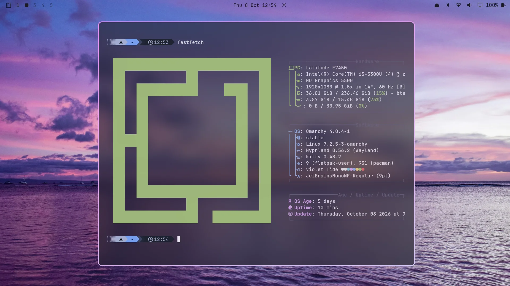
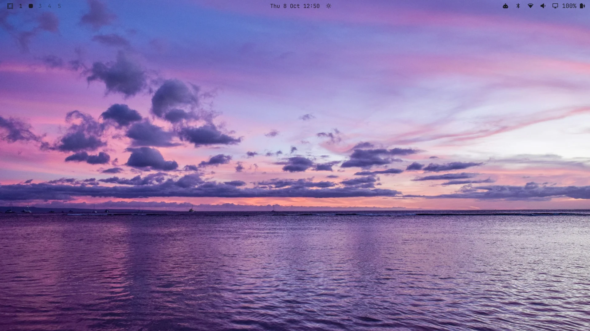
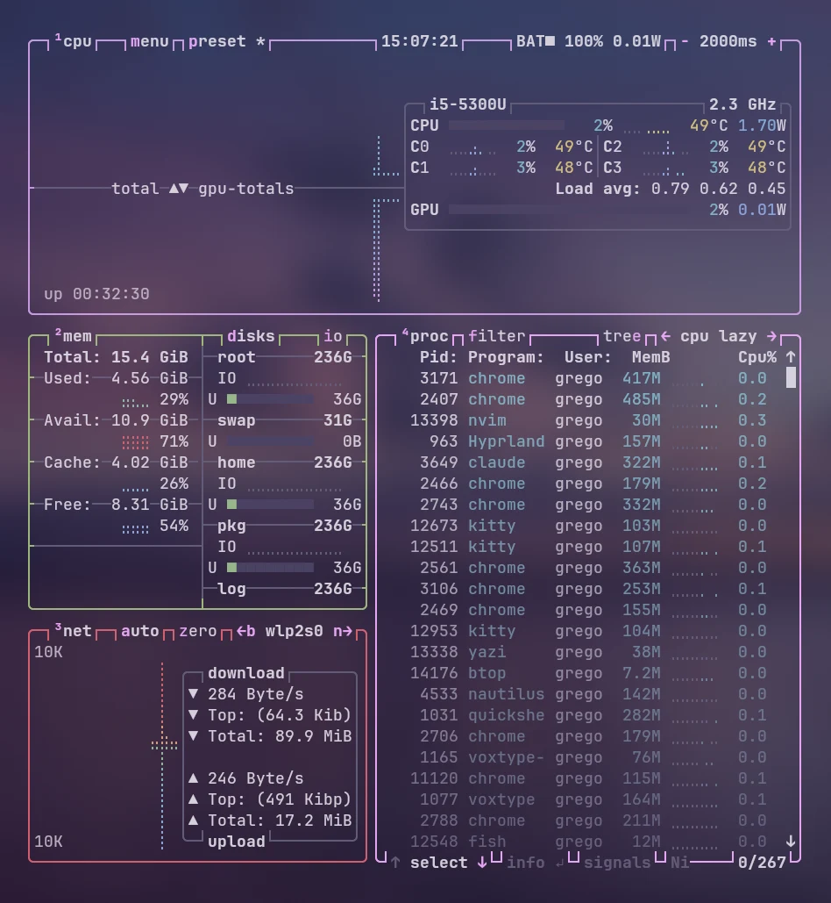
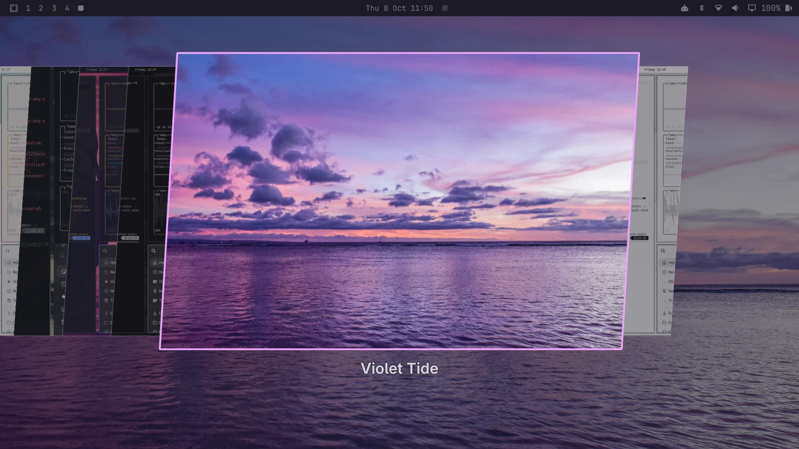

# Violet Tide — an Omarchy theme

A purple dusk over the sea for [Omarchy](https://omarchy.org/): a dark
slate-purple background, soft grey-white text, a pink-to-lavender window
border, and see-through terminals with the wallpaper blurred behind
them.





- `background = #1b1a24`, `foreground = #d6d2dc`, `accent = #e8a6f5`
- Terminal hues: `red #d4606e`, `yellow #d9c27e`, `orange #e0a070`,
  `green #9db87a`, `cyan #7fb4c6`, `blue #8aa4dc`, `magenta #c79be0`
  (plus brights)
- Active window border: a `#f590f8` to `#ddcdfc` gradient, square
  corners
- Folder icons: Yaru purple
- 4 bundled backgrounds in `backgrounds/`; the purple and blue sunset is
  the default



## Install

```bash
omarchy theme install https://github.com/ggregoro/violet-tide
omarchy theme set "Violet Tide"
```

Cycle backgrounds with `Super+Ctrl+Space` or `omarchy theme bg next`.



That gives you the colors, the border, the icons and the wallpapers.

## The see-through look (optional)

The frosted, see-through terminals need two more things. Omarchy does
not take either from a theme installed with `omarchy theme install`
(such a theme may only supply colors), so they are set up by hand.

**1. Blur.** Omarchy ships with blur off. Add this to
`~/.config/hypr/looknfeel.lua` to turn it on:

```lua
hl.config({
  decoration = {
    blur = { enabled = true, size = 6, passes = 3 },
  },
})
```

The theme's own `hyprland.lua` holds the same setting, and it is used
as-is if you keep the theme as your own folder or a link to your own
copy instead of a clone:

```bash
git clone https://github.com/ggregoro/violet-tide ~/Projects/violet-tide
ln -s ~/Projects/violet-tide ~/.config/omarchy/themes/violet-tide
omarchy theme set "Violet Tide"
```

**2. Terminal opacity.** `terminal-opacity` holds the level this theme
wants (`0.60`). `extras/terminal-opacity` is a small hook that applies
it to Kitty and foot each time the theme changes, and puts every other
theme back to `0.90`:

```bash
omarchy hook install theme-set extras/terminal-opacity
```

Then, in `~/.config/kitty/kitty.conf`, replace any `background_opacity`
line with:

```
include theme-opacity.conf
```

For foot the hook rewrites the `alpha=` line in
`~/.config/foot/foot.ini`, if there is one. Re-apply the theme once and
the level is set.

## Tweaking

Edit `colors.toml`, then re-run `omarchy theme set "Violet Tide"`.
Terminal colors, the bar, btop and Neovim regenerate from it. Change the
number in `terminal-opacity` for more or less see-through.

## Credits & licensing

The bundled wallpapers are photos from [Unsplash](https://unsplash.com/),
used under the Unsplash License and cropped to 16:9:

- Purple and blue sunset over water, by Engin Yapici
- Purple sky over a dark, calm ocean, by Artiom Vallat
- Islands in the calm ocean at twilight, by Loris Boulinguez
- Pink and purple sunset over the ocean waves, by Vishnu K R

Swap `backgrounds/` for your own if you prefer. Theme files
(`colors.toml`, `hyprland.lua`, `icons.theme`, `terminal-opacity`,
`extras/`, this README) are MIT-licensed — see `LICENSE`.
